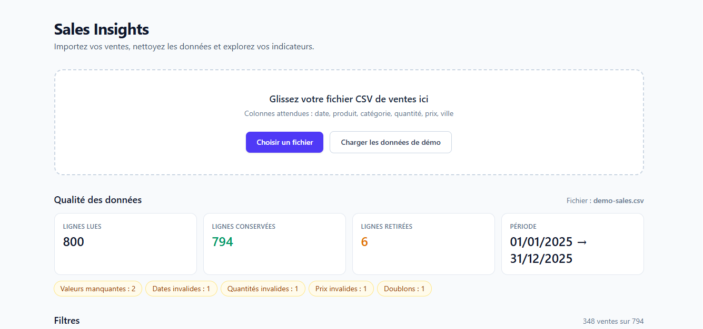

# Sales Insights

Tableau de bord d'analyse des ventes : importe un fichier CSV, nettoie les données, puis explore des indicateurs et des graphiques filtrables.

**Démo en ligne : https://sales-insights-three.vercel.app/**

Clique sur le bouton des données de démo pour tester l'application en un clic, sans rien importer.



## Fonctionnalités

- **Import CSV** par glisser-déposer, ou chargement de données de démo (800 lignes).
- **Nettoyage automatique** : doublons, valeurs manquantes, dates et nombres invalides, formats français (virgule décimale, dates `jj/mm/aaaa`).
- **Rapport de qualité des données** : ce qui a été corrigé ou écarté, et pourquoi.
- **Tableau de données** avec recherche, tri et pagination.
- **5 indicateurs clés** : chiffre d'affaires, nombre de ventes, panier moyen, unités vendues, croissance mensuelle.
- **4 graphiques** : évolution mensuelle, ventes par catégorie, par ville, top 5 des produits.
- **Filtres** par période, catégorie et ville, appliqués aux KPI, aux graphiques et au tableau.
- **Export CSV** des données filtrées (séparateur `;`, compatible Excel).

## Confidentialité

Le fichier CSV est traité **directement dans le navigateur** : les données ne quittent pas l'ordinateur de l'utilisateur.

## Technologies

| Rôle | Outil |
| --- | --- |
| Framework | Next.js 15 (App Router, JavaScript) |
| Style | Tailwind CSS 4 |
| Lecture des CSV | PapaParse |
| Graphiques | Recharts |
| Authentification et sauvegarde (optionnel) | Supabase |
| Déploiement | Vercel |

## Lancer le projet en local

Prérequis : [Node.js](https://nodejs.org/) installé.

```bash
git clone https://github.com/Yohane2000/sales-insights.git
cd sales-insights
npm install
npm run dev
```

Puis ouvre http://localhost:3000.

Sans configuration Supabase, l'application fonctionne en **mode local** : pas de connexion ni de sauvegarde, tout le reste est disponible.

## Commandes utiles

```bash
npm run dev          # lancer en développement
npm run build        # compiler pour la production
npm run test:clean   # tester la logique de nettoyage, KPI, filtres et export
```

## Structure du projet

```
app/            pages et styles globaux
components/     interface (import, rapport qualité, tableau, KPI, graphiques, filtres...)
lib/            logique métier (nettoyage, analyses, filtres, export CSV, Supabase)
public/         données de démo (demo-sales.csv)
scripts/        génération des données de démo et tests de la logique
supabase/       schéma SQL (tables et politiques RLS)
docs/           capture d'écran du README
```

## Choix techniques

- **Logique séparée de l'interface** : le nettoyage, les KPI, les filtres et l'export sont des fonctions indépendantes de React, donc testables avec `npm run test:clean`.
- **Données de démo volontairement imparfaites** : le jeu de 800 lignes contient des doublons et des valeurs invalides pour montrer le nettoyage en action.
- **Sécurité Supabase** : la clé `anon` est publique par conception, la protection des données repose sur les politiques RLS (Row Level Security). La clé `service_role` ne doit jamais être exposée.

## Pistes d'amélioration

- Mode sombre
- Activation de la sauvegarde des jeux de données avec Supabase
- Notebook Python (pandas) avec des conclusions chiffrées sur le même jeu de données

## Auteur

Yohane, développeur web et analyste de données basé au Sénégal. [GitHub](https://github.com/Yohane2000)
